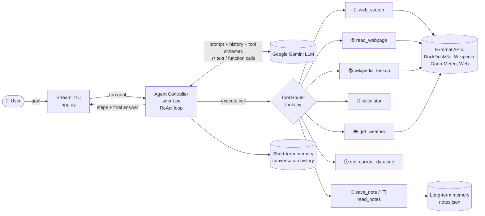
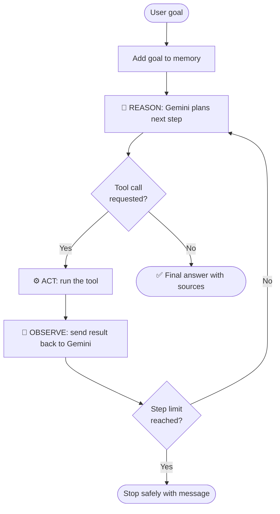

# 🤖 Agentic AI Research Assistant

An **autonomous AI agent** built with **Google Gemini** and **Streamlit**.
Give it a goal in plain English: it **plans** the steps, **decides which tools to use** on its own,
**observes** the results, **reflects** and retries if needed, and finally returns a sourced answer.
It also has **short-term memory** (the conversation) and **long-term memory** (saved notes).

> Assignment option: **(i) Agentic Agent**

---

## ✨ Features

| Agentic capability | How it is implemented |
|---|---|
| **Goal understanding & planning** | System prompt makes Gemini break each goal into steps and state a plan |
| **Autonomous tool selection** | Gemini *function calling*: the model chooses which tool(s) to call and with what arguments |
| **ReAct loop** (Reason → Act → Observe) | Hand-written loop in `agent.py`, repeats until the goal is complete |
| **Self-correction** | Tool errors are returned to the model, which retries with another tool or query |
| **Short-term memory** | Full conversation history is sent on every turn |
| **Long-term memory** | `save_note` / `read_notes` tools persist notes in `notes.json` |
| **Safety guard** | Max-step limit, safe calculator (no `eval`), request timeouts |
| **Transparency** | Every plan, tool call, arguments and observation is shown live in the UI |

### 🧰 Tools the agent can use

| Tool | Purpose | API used (all free, no key) |
|---|---|---|
| `web_search` | Search the internet for current info | DuckDuckGo (`ddgs`) |
| `read_webpage` | Read the text of a web page | `requests` + BeautifulSoup |
| `wikipedia_lookup` | Encyclopedia summary of a topic | Wikipedia REST API |
| `calculator` | Exact math (compound interest, etc.) | Safe AST evaluator |
| `get_weather` | Current weather + 3-day forecast | Open-Meteo |
| `get_current_datetime` | Today's date/time in any timezone | Python `zoneinfo` |
| `save_note` | Save information to long-term memory | Local JSON file |
| `read_notes` | Recall saved notes | Local JSON file |

---

## 🏗️ Schema / Architecture


### System architecture



### Agent loop (ReAct)



### Data schema

```text
Conversation memory (in RAM)       Long-term memory (notes.json)
--------------------------------   ------------------------------
Content                             Note
  role:  "user" | "model"            title:     string
  parts: [ text                      content:   string
         | function_call(name,args)  saved_at:  "YYYY-MM-DD HH:MM"
         | function_response(name,
              {"result": str}) ]

Agent event (streamed to the UI)
  type:  "thought" | "tool_call" | "tool_result" | "final" | "error"
  step:  int      name: tool name      args: dict      text/result: string
```

---

## 📁 Project structure

```
agentic-research-agent/
├── app.py                    # Streamlit web UI
├── agent.py                  # Agent brain: ReAct loop with Gemini function calling
├── tools.py                  # The 8 tools the agent can use
├── cli.py                    # Optional: run the agent in the terminal
├── requirements.txt
├── schema/architecture.png   # Architecture diagram
├── .streamlit/secrets.toml.example
└── README.md
```

---

## 🚀 Run it locally

1. **Get a free Gemini API key** at <https://aistudio.google.com/apikey>.
2. Install Python 3.10+ and the dependencies:
   ```bash
   git clone https://github.com/<your-username>/agentic-research-agent.git
   cd agentic-research-agent
   pip install -r requirements.txt
   ```
3. Start the app:
   ```bash
   streamlit run app.py
   ```
4. Paste your API key in the sidebar (or put it in `.streamlit/secrets.toml`, see the example file).

Terminal version: set `GEMINI_API_KEY` as an environment variable and run `python cli.py`.

## ☁️ Deploy free on Streamlit Cloud (optional)

1. Push this repo to GitHub.
2. Go to <https://share.streamlit.io>, click **Create app**, choose this repo and `app.py`.
3. Under **Advanced settings → Secrets**, add: `GEMINI_API_KEY = "your-key"`.
4. Click **Deploy** to get a public link.

---

## 💡 Example goals

- *"What is the weather in Chennai right now, and should I carry an umbrella tomorrow?"* → `get_weather`
- *"Research the latest developments in solar energy and save a short summary as a note."* → `web_search` → `read_webpage` → `save_note`
- *"Who was Srinivasa Ramanujan? How many years ago was he born?"* → `wikipedia_lookup` → `get_current_datetime` → `calculator`
- *"If I invest ₹50,000 at 8% compounded yearly, what will I have after 12 years?"* → `calculator`

## 🛠️ Tech stack

Python · Google Gemini API (`google-genai` SDK, function calling) · Streamlit · DuckDuckGo Search · Wikipedia API · Open-Meteo API

## ⚠️ Notes

- The free Gemini tier has rate limits; if you see a 429 error, wait a minute or pick another model in the sidebar.
- Notes are stored in a local file; on Streamlit Cloud they reset when the app restarts.
